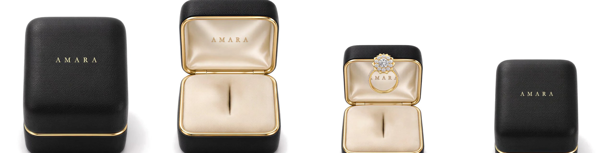

# AMARA — jewellery website

A scroll-driven concept site for a fine-jewellery brand. One ring is followed from the opening film,
through four chapters (anatomy, atelier, exploded parts, configure), into its box, which closes on the last scroll.

**Live:** https://amara-jewellery-five.vercel.app

Static site: plain HTML, CSS and JavaScript, no build step.



## Run it

```bash
node tools/serve.mjs site 5533
```

Then open http://localhost:5533. Any static file server pointed at `site/` works too.

On Windows, double-clicking `start-site.bat` does both steps. The address only works on the computer that is
running the server, and only while it is running.

## Deploy

The Vercel project `amara-jewellery` is connected to this repository: every push to `main` deploys.
The page lives in `site/`, not at the repository root, so `vercel.json` tells Vercel to serve that folder
(`"outputDirectory": "site"`). Without it the deploy succeeds but every address returns 404.

## What is in here

| Path | What it is |
| --- | --- |
| `site/index.html` | The single page: header, hero, five scroll chapters, footer, drawers, catalogue sheet, quick-view modal |
| `site/css/style.css` | Base styles, header, hero, cards, drawers, catalogue, modal |
| `site/css/journey.css` | The pinned scroll chapters and the box finale |
| `site/js/main.js` | Catalogue data, bag and wishlist (saved in `localStorage`), search, filters, quick view |
| `site/js/journey.js` | The scroll choreography: moves the ring between chapters and plays the frame sequences on canvas |
| `site/assets/turn/` | 2 × 61 frames: the ring turning, and coming apart into its four pieces |
| `site/assets/box/` | 3 × 61 frames: the box opening, the ring dropping in, the box closing |
| `site/vendor/` | GSAP, ScrollTrigger and Lenis (smooth scroll) |
| `tools/serve.mjs` | Tiny static server with range requests, for local preview |
| `tools/box-rebrand/` | The script that printed the brand name onto the box frames (see below) |
| `tools/hero-film/` | The script that makes the hero film from the ring-turn frames (see Notes) |

## Changing the brand name

The name lives in two kinds of place:

1. **Text** — `site/index.html` (title, description, header logo, footer, one paragraph, one aria-label) and
   `site/js/main.js` / `site/js/journey.js` (the `window.AMARA` object and the `amara:` storage prefix).
2. **Pixels** — the name is foil-stamped on the ring box, outside the lid and on the lining inside it, in all
   183 frames of `site/assets/box/`. `tools/box-rebrand/rebrand_box.py` handles that: for every frame it finds
   the old letters, paints them out with leather or satin texture taken from the gaps between the letters, and
   prints the new name in the same place, at the same size and tilt, in the colours of the foil it replaces.

To print a different name, run the script against the **original** frames (the ones from the source repo, which
still carry the old name), not the ones in this folder:

```bash
python tools/box-rebrand/rebrand_box.py path/to/original/box site/assets/box NEWNAME C:/Windows/Fonts/GARA.TTF
```

It needs Python with `opencv-python`, `numpy` and `Pillow`, and takes about five minutes. Names of four to seven
capitals fit the lid best. Add `open`, `drop` or `close` as a last argument to redo just one sequence.

## Notes

- Prices are in rupees and the checkout is not connected: this is a concept store.
- `site/assets/hero.mp4` is the ring turning in the dark, a 14-second seamless loop. The source repo never shipped
  its film, so `tools/hero-film/make_hero_film.py` builds one from the real turning footage in `site/assets/turn/`
  (shot on white): it cuts the ring out of each frame, sets it on black, plays the turn forwards and back, and
  adds a band of light, shimmering facets and glints. `hero-poster.jpg` is the film's first frame. To re-render
  both (about eight minutes):

  ```bash
  python tools/hero-film/make_hero_film.py site/assets/turn site/assets/hero.mp4
  ```

  ```bash
  python tools/hero-film/make_hero_film.py site/assets/turn x.mp4 --poster site/assets/hero-poster.jpg
  ```

  The shipped file was then re-encoded at a lower bitrate (6 MB instead of 12). The source repo's own still is
  kept as `tools/hero-film/original-poster.jpg`. Replace `hero.mp4` with real footage when there is some;
  nothing else needs to change.
- Motion is switched off for visitors who ask for reduced motion.

## Credit

Layout, code and imagery are adapted from
[gireeshkumarreddy/calla-jewellery-website](https://github.com/gireeshkumarreddy/calla-jewellery-website).
That repository carries no licence file, so ask its author before publishing this commercially or presenting it
as original work.
